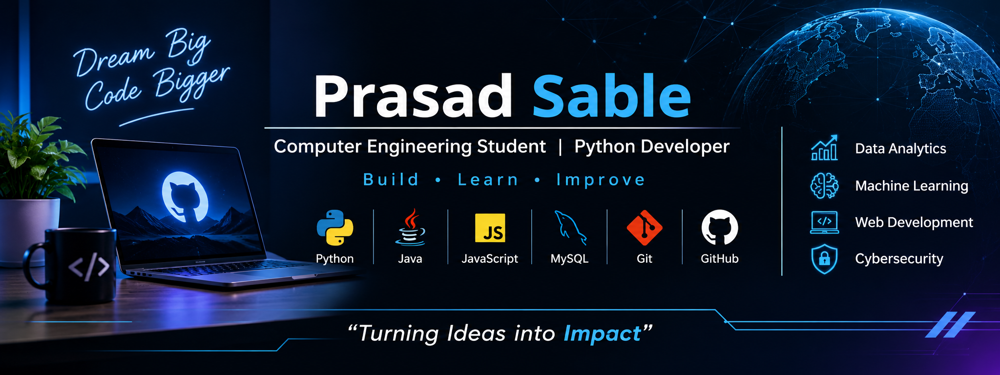

  

 

# 👋 Hi, I'm Prasad Sable

### 💻 Computer Engineering Student | Python Developer | Aspiring Software Engineer

Building practical applications, exploring data, and developing intelligent solutions.

---

## 👨‍💻 About Me

* 🎓 Computer Engineering Diploma Student.
* 🐍 Interested in Python Development and Data Analytics.
* 🤖 Exploring Machine Learning and AI.
* 🚀 Building practical software projects.
* 🎯 Preparing for software development and data-related internships.

---

## 🛠️ Tech Stack

### Areas of Interest

* Data Analytics
* Machine Learning
* Backend Development
* Web Development
* Artificial Intelligence

---

## 🚀 Featured Projects

| Project          | Description                                   | Technology |
| ---------------- | --------------------------------------------- | ---------- |
| 📊 DataPilot     | Data analysis supporting CSV, Excel and JSON  | Python     |
| 📈 SmartStock ML | Product demand prediction using Random Forest | Python, ML |
| 💰 SpendSense    | Monthly budget tracking                       | Python     |

---

## 📊 GitHub Statistics

---

## 🎯 Current Focus

* Improving Python and programming fundamentals.
* Building machine learning projects.
* Learning backend development.
* Developing real-world applications.
* Participating in hackathons and technical competitions.

---

## 🤝 Connect With Me

---

### 💡 "Build. Learn. Improve. Repeat."

